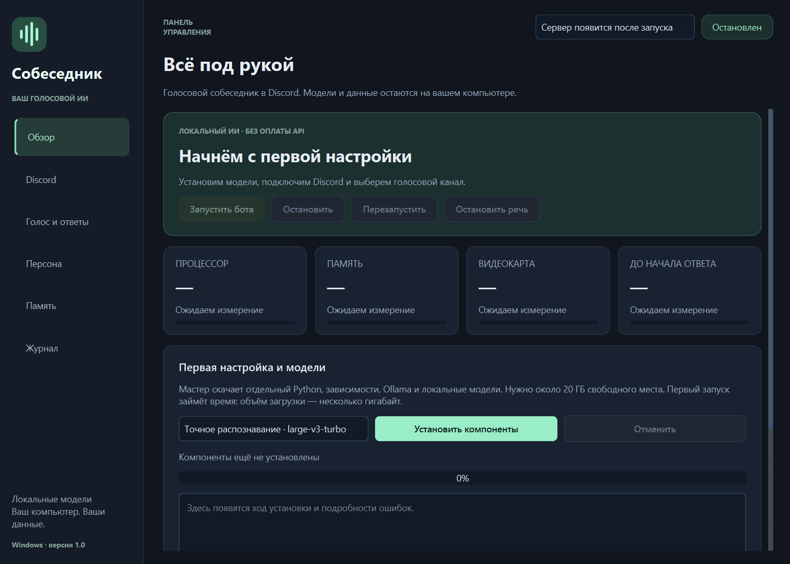

# Собеседник (Sobesednik)

### Локальный голосовой ИИ-бот для Discord на Windows

**Собеседник** — бесплатный Discord-бот с искусственным интеллектом: общается на русском,
отвечает голосом и запоминает участников. Настройте характер и решайте сами, что он запомнит.
Модели работают на вашем компьютере, без подписки и платных API.

*Sobesednik is an open-source local AI voice companion for Discord, with Russian speech,
participant memory and a Windows installer.*

**[⬇ СКАЧАТЬ ДЛЯ WINDOWS · EXE](https://github.com/Roland525/sobesednik/releases/download/v1.0.1/Sobesednik-Setup-1.0.1.exe)**

[Первая настройка](docs/GUIDE.md#как-получить-токен-бота) · [Все выпуски](https://github.com/Roland525/sobesednik/releases) · [Сообщить о проблеме](https://github.com/Roland525/sobesednik/issues)

## Один установщик — всё управление в приложении

| Общайтесь | Настраивайте | Управляйте |
| :--- | :--- | :--- |
| Ответы голосом в Discord | Голос, темп и громкость | Сервер и голосовой канал |
| Короткие ответы и объяснения по просьбе | Характер и манера общения | Запуск, остановка и нагрузка |
| Память об участниках | История текущего разговора | Просмотр и удаление памяти |

Распознавание речи, разговорная модель и озвучка работают локально.
Новая установка начинает с пустой памятью. Мат не запикивается; манеру общения выбираете вы.

## Начните с трёх шагов

1. **Установите приложение.** Скачайте EXE по кнопке выше и откройте ярлык «Собеседник».
2. **Установите компоненты.** На вкладке «Обзор» нажмите «Установить компоненты» — приложение загрузит Python, зависимости и модели.
3. **Подключите Discord.** Создайте своего бота по [короткой инструкции](docs/GUIDE.md#как-получить-токен-бота), вставьте токен в приложении и пригласите его на сервер. Запустите бота и выберите голосовой канал.

> **«Собеседник, почему небо голубое?»**
>
> **«Собеседник, запомни: моя любимая игра — Dota 2».**
>
> **«Собеседник, помолчи».**

Имя можно сказать в начале, середине или конце вопроса. Команда «помолчи» останавливает речь; новое обращение по имени снова разрешает ответ.

## Перед установкой

**Windows x64 · минимум 20 ГБ свободного места.** Рекомендуются NVIDIA с 8 ГБ видеопамяти и 32 ГБ оперативной памяти. На CPU ответы существенно медленнее.

Первый запуск требует загрузки нескольких гигабайт. Установщик занимает около 35 МБ; модели скачиваются отдельно. Заранее устанавливать Python не нужно.

<strong>Полезно знать: приватность, ограничения и обновления</strong>

- Токен новой установки защищён Windows DPAPI. Память и настройки хранятся на вашем компьютере.
- Интернет нужен для Discord и загрузки компонентов; чтение официальных патчноутов Dota 2 включается отдельно.
- Бот может ошибаться. Просмотр демонстраций Discord Go Live пока не реализован.
- Постоянная память доступна сразу. Обучение весов — отдельная экспериментальная функция с дополнительными требованиями.
- EXE пока без цифровой подписи издателя. Контрольная сумма опубликована в [выпуске](https://github.com/Roland525/sobesednik/releases/tag/v1.0.1).
- Удаление приложения сохраняет модели и память в `%LOCALAPPDATA%\Sobesednik`; подробности — в [руководстве](docs/GUIDE.md).

## Нужна помощь?

[Руководство пользователя](docs/GUIDE.md) · [Настройка обучения](docs/LOCAL_LEARNING.md) · [Для разработчиков](docs/DEVELOPMENT.md)

Если Собеседник оказался полезен, поставьте репозиторию **звезду ⭐** — так проект проще найти другим.

---

Код открыт под [MIT](LICENSE). Основан на [discospeech](https://github.com/ajr-dev/discospeech). [Лицензии компонентов](app/NOTICES.md).
